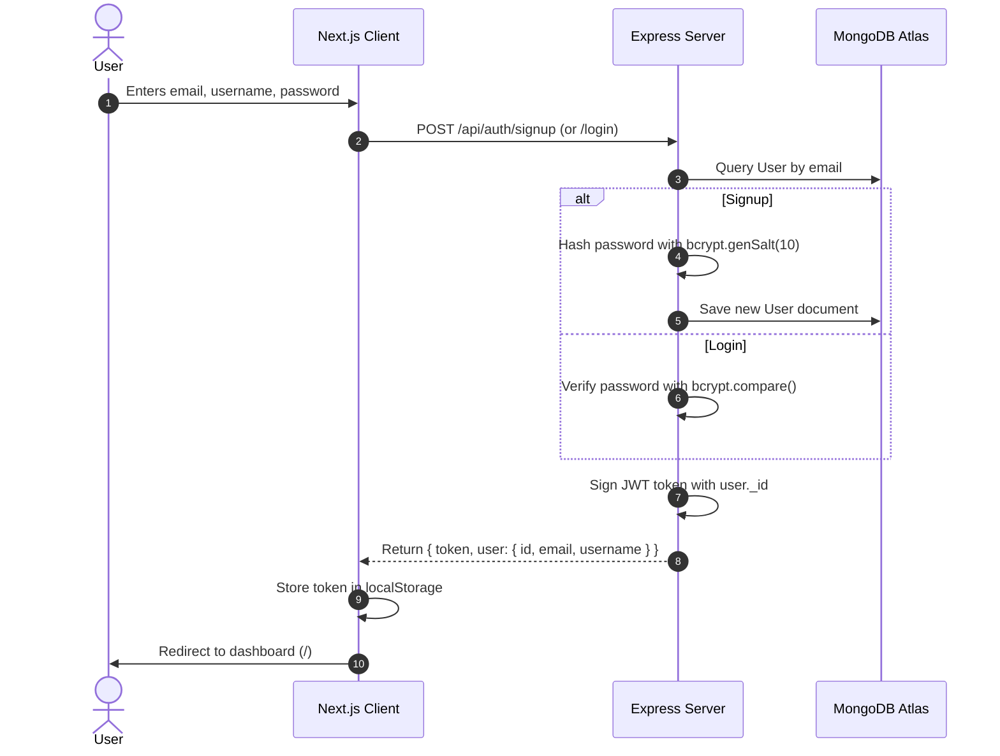
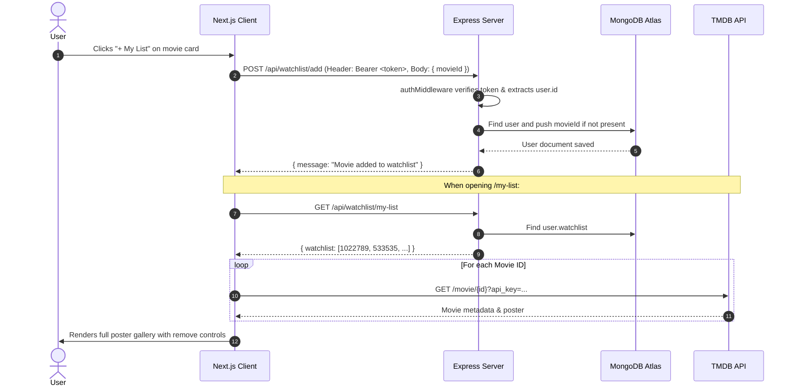
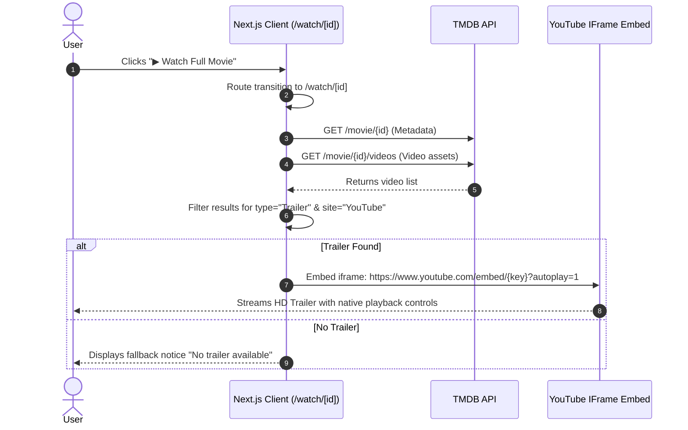

# 🏛️ Netflix Clone - Technical Architecture & Model Summary

This document provides a comprehensive technical reference for the Netflix Clone project, detailing the system architecture, component design, database models, data structures, API contracts, authentication workflows, and external third-party integrations.

---

## 📑 Table of Contents
1. [System Architecture Overview](#system-architecture-overview)
2. [Technology Stack](#technology-stack)
3. [Database & Data Models](#database--data-models)
   - [User Model (Mongoose)](#user-model-mongoose)
   - [Movie Entity Model (TMDB)](#movie-entity-model-tmdb)
   - [Video Trailer Model (TMDB)](#video-trailer-model-tmdb)
   - [Authentication Token Model (JWT)](#authentication-token-model-jwt)
4. [Application Data Flow](#application-data-flow)
   - [Authentication Flow](#authentication-flow)
   - [Watchlist Synchronization Flow](#watchlist-synchronization-flow)
   - [Trailer Playback Flow](#trailer-playback-flow)
5. [API Specification](#api-specification)
   - [Backend REST Endpoints](#backend-rest-endpoints)
   - [Third-Party TMDB Endpoints](#third-party-tmdb-endpoints)
6. [Security & Performance Model](#security--performance-model)

---

## 1. System Architecture Overview

The application follows a decoupled **Client-Server Architecture**:

```
+-------------------------------------------------------------+
|                      CLIENT APPLICATION                     |
|                  Next.js 16 + React 19 + Tailwind           |
|  - App Router (/auth, /my-list, /search, /watch/[id])       |
|  - Client State & Token Storage (localStorage)              |
+--------------+------------------------------+---------------+
               |                              |
       Direct TMDB Queries             REST API Calls
 (Catalog, Metadata, Trailers)   (Auth, Watchlist Management)
               |                              |
               v                              v
+-----------------------------+  +----------------------------+
|        TMDB REST API        |  |       EXPRESS SERVER       |
| (themoviedb.org v3 API)     |  | Node.js + Express 5        |
| - Movie Lists               |  | - Auth Controller          |
| - Search Multi              |  | - Watchlist Controller     |
| - Video Trailer Keys        |  | - JWT Middleware           |
+-----------------------------+  +-------------+--------------+
                                               |
                                        Mongoose ODM
                                               |
                                               v
                                 +----------------------------+
                                 |       MONGODB ATLAS        |
                                 | - User Accounts            |
                                 | - Hashed Passwords         |
                                 | - Watchlist Movie IDs      |
                                 +----------------------------+
```

---

## 2. Technology Stack

| Layer | Technology | Version | Purpose |
| :--- | :--- | :--- | :--- |
| **Frontend Framework** | Next.js (App Router) | 16.4.3 | SSR/CSR rendering, file-based routing |
| **Frontend Library** | React | 19.3.0 | Component-driven declarative UI |
| **Styling** | Tailwind CSS / Turbopack | ^4.0 | Utility-first Netflix dark-theme design |
| **Language** | TypeScript & JavaScript | TypeScript 5 | Strict typing for client entities |
| **Backend Framework** | Node.js / Express | Express 5.3.0 | RESTful API server |
| **Database** | MongoDB & Mongoose | Mongoose 9.11.3 | Document database & Object Data Modeling |
| **Authentication** | JSON Web Token (JWT) | jsonwebtoken 9.0.3 | Stateless token-based user authentication |
| **Password Security** | BcryptJS | 3.0.3 | Password hashing with salt rounds |
| **Security Headers** | Helmet | 8.3.0 | Secure HTTP response headers |
| **CORS** | cors | 2.8.6 | Cross-origin resource sharing policy |
| **Media Service** | TMDB (The Movie Database) | v3 REST API | Posters, backdrops, metadata, and trailers |

---

## 3. Database & Data Models

### User Model (Mongoose)
The primary persistence schema stored in MongoDB Atlas:
- **Location**: `server/models/User.js`
- **Collection**: `users`

```typescript
interface IUser {
  _id: mongoose.Types.ObjectId;
  email: string;        // Unique, lowercase, trimmed string
  password: string;     // One-way hashed string via Bcrypt (salt round = 10)
  username: string;     // Display name string
  watchlist: number[];  // Array of TMDB Movie IDs (or ObjectIds)
  createdAt: Date;      // Timestamp of creation (default: Date.now)
}
```

#### Schema Definition:
```javascript
const userSchema = new mongoose.Schema({
  email: {
    type: String,
    required: true,
    unique: true,
    trim: true,
    lowercase: true,
  },
  password: {
    type: String,
    required: true,
  },
  username: {
    type: String,
    required: true,
  },
  watchlist: [{
    type: mongoose.Schema.Types.Mixed, // Stores TMDB movie ID
  }],
  createdAt: {
    type: Date,
    default: Date.now,
  },
});
```

#### Instance Methods:
- `comparePassword(candidatePassword)`: Compares a plain-text candidate password with the hashed password stored in the database using `bcrypt.compare`.

---

### Movie Entity Model (TMDB)
Client-side movie contract received from TMDB:
- **Location**: `client/src/lib/tmdb.ts`

```typescript
export interface Movie {
  id: number;                   // Unique TMDB numeric identifier
  title?: string;               // Movie title (for theatrical films)
  name?: string;                // Series name (for TV shows)
  poster_path: string | null;   // Poster asset relative path
  backdrop_path: string | null; // Hero backdrop asset relative path
  overview: string;             // Plot summary / synopsis
  vote_average?: number;        // Rating score (e.g., 8.4)
  release_date?: string;        // Theatrical release date (YYYY-MM-DD)
  runtime?: number;             // Runtime in minutes
  genres?: Array<{              // Category genres
    id: number;
    name: string;
  }>;
}
```

---

### Video Trailer Model (TMDB)
Payload returned from TMDB video query (`/movie/{id}/videos`):
- Filtered on `type === 'Trailer'` and `site === 'YouTube'`.

```typescript
interface TMDBVideo {
  id: string;
  iso_639_1: string;
  iso_3166_1: string;
  key: string;          // YouTube 11-character video ID (e.g. "dQw4w9WgXcQ")
  name: string;         // Name of trailer / teaser
  site: string;         // Platform ("YouTube")
  size: number;         // Quality resolution (720, 1080)
  type: string;         // Video type ("Trailer", "Teaser", "Featurette")
  official: boolean;
}
```

---

### Authentication Token Model (JWT)
The authorization model uses signed JSON Web Tokens:
- **Signing Algorithm**: HMAC SHA-256 (`HS256`)
- **Default Expiration**: 7 days (`7d`)
- **Secret**: `process.env.JWT_SECRET` (fallback: `'secret123'`)
- **Token Payload**:
```json
{
  "id": "673f4e9184b2c14092b740ef",
  "iat": 1729777200,
  "exp": 1730382000
}
```

---

## 4. Application Data Flow

### Authentication Flow


### Watchlist Synchronization Flow


### Trailer Playback Flow


---

## 5. API Specification

### Backend REST Endpoints
Base URL: `http://localhost:5000`

| Method | Endpoint | Protection | Request Body | Response Success |
| :--- | :--- | :--- | :--- | :--- |
| `POST` | `/api/auth/signup` | Public | `{ email, password, username }` | `201 Created`: `{ token, user }` |
| `POST` | `/api/auth/login` | Public | `{ email, password }` | `200 OK`: `{ token, user }` |
| `GET` | `/api/watchlist/my-list` | Protected (`Bearer <token>`) | None | `200 OK`: `{ watchlist: [...] }` |
| `POST` | `/api/watchlist/add` | Protected (`Bearer <token>`) | `{ movieId }` | `201 Created`: `{ message }` |
| `POST` | `/api/watchlist/remove` | Protected (`Bearer <token>`) | `{ movieId }` | `200 OK`: `{ message }` |
| `GET` | `/debug` | Public | None | `200 OK`: `{ status, timestamp }` |
| `GET` | `/` | Public | None | `200 OK`: Server welcome message |

---

### Third-Party TMDB Endpoints
Base URL: `https://api.themoviedb.org/3`

| Category | Endpoint | Purpose |
| :--- | :--- | :--- |
| **Trending** | `/trending/all/week` | Feeds the "Trending Now" carousel |
| **Netflix Originals** | `/discover/tv?with_networks=213` | Curates Netflix-original TV productions |
| **Top Rated** | `/movie/top_rated` | High-scoring critically acclaimed titles |
| **Action** | `/discover/movie?with_genres=28` | Action genre catalog |
| **Search** | `/search/multi?query={query}` | Global search query across titles and actors |
| **Details** | `/movie/{id}` | Full runtime, genres, vote average, and overview |
| **Trailers** | `/movie/{id}/videos` | Discovers YouTube video keys for playback |

---

## 6. Security & Performance Model

1. **Password Encryption**: Passwords are never stored in plaintext. They are salted and hashed using Bcrypt before saving to MongoDB Atlas.
2. **Stateless Authorization**: JWT eliminates the need for server-side sessions, scaling easily with microservices and cloud deployments.
3. **Helmet Header Protection**: HTTP headers are secured against Cross-Site Scripting (XSS), MIME sniffing, clickjacking, and open redirections.
4. **CORS Isolation**: Restricts API calls to authorized origins.
5. **Client-Side Optimization**: Built with Next.js 16 featuring image optimizations, font prefetching via `next/font/google`, and React 19 concurrent features.

